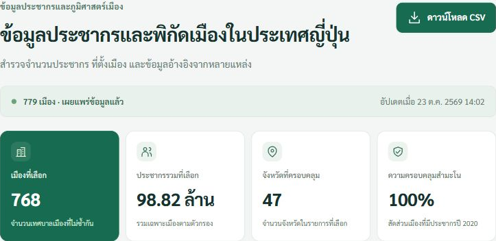
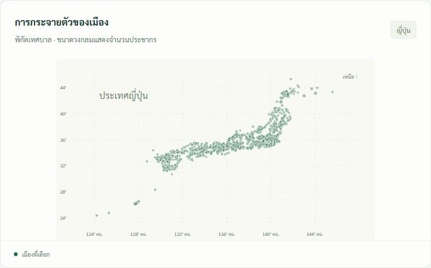
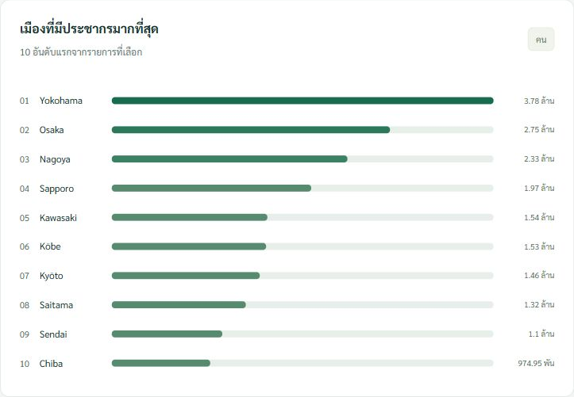

# Japan City Atlas

ระบบรวบรวม **ประชากรและพิกัดเมืองญี่ปุ่นอย่างน้อย 100 เมือง** จาก UNdata, GeoNames และ e-Stat ด้วย Apache Airflow แล้วแสดงผลบนเว็บที่อ่าน PostgreSQL โดยตรง

รายวิชา 02739452 | ลำดับที่ 32 | รหัสนิสิต 6621604840

Repository: [02739452-32-6621604840](https://github.com/PhattaradanaiKru/02739452-32-6621604840)

## ผลลัพธ์ที่ตรวจสอบแล้ว

รอบทดสอบ `submission_verified` วันที่ 23 ตุลาคม 2569 รวบรวมได้ **779 เมืองไม่ซ้ำ ครอบคลุม 47 จังหวัด** โดย **768 เมืองมีประชากรปี ค.ศ. 2020** และอีก 11 เมืองใช้ประชากรจาก GeoNames ที่ไม่ระบุปี หน้าเว็บเริ่มต้นกรองปี 2020 จึงแสดง 768 เมือง ตัวเลขนี้เป็นผลรอบทดสอบ จำนวนที่ได้เมื่อรันใหม่ขึ้นอยู่กับข้อมูลและการเข้าถึงแต่ละแหล่ง



| การกระจายตัวตามพิกัด | เมืองที่มีประชากรมากที่สุด |
|---|---|
|  |  |

## ขอบเขตที่ทำสำเร็จ

| ระดับ | สิ่งที่ทำและตรวจสอบแล้ว |
|---|---|
| ระดับ 1 | DAG ดึง-แปลง-บันทึกลง PostgreSQL และเว็บอ่านฐานข้อมูลโดยตรง มีตารางและกราฟ |
| ระดับ 2 | TaskGroup ดึงข้อมูลขนาน รวม schema ใช้ UPSERT รันซ้ำไม่เพิ่มรายการซ้ำ มี KPI และตัวกรอง |
| ระดับ 3 | ดึงครบ 3 แหล่ง ทำต่อเมื่อบางแหล่งล่ม รวมเมืองซ้ำข้ามแหล่ง ตรวจคุณภาพและแยกเส้นทาง `publish` / `quarantine` |
| โบนัส | หน้าสถานะ Pipeline บนเว็บ แสดงสถานะแหล่งข้อมูลและประวัติการทำงาน |

หลักฐาน Graph view, Grid view และผลทดสอบอยู่ใน [บันทึกการตรวจระบบ](reports/validation.md) ระบบรันผ่าน Docker บนเครื่อง ยังไม่ได้ขึ้นคลาวด์

## สิ่งที่ทำได้

- ใช้ Airflow **2.10.4 + CeleryExecutor + Redis** แยก PostgreSQL metadata กับ PostgreSQL target
- ดึงข้อมูลจริง 3 แหล่ง โดย **scraping HTML ด้วย requests + BeautifulSoup** จาก GeoNames และ UNdata ไม่ใช้ Selenium
- TaskGroup แยก 3 แหล่ง รันขนานกัน เก็บ raw response, URL, เวลาดึง และ SHA-256
- รวม schema จับคู่เมือง ตัดซ้ำด้วย GeoNames ID และ UPSERT ทั้งเมืองและประชากรแยกแหล่ง/ปี
- เมื่อแหล่งหนึ่งล่ม merge ยังทำต่อด้วย `all_done` และเผยแพร่ข้อมูลที่ผ่านเกณฑ์เป็น `degraded`
- ตรวจคุณภาพแล้วใช้ branch แยก `publish` / `quarantine`; เมื่อไม่ผ่านจะรักษาชุดข้อมูลที่เผยแพร่เดิม
- Dashboard มี KPI ตัวกรอง กราฟอันดับประชากร แผนภาพพิกัด ตารางค้นหา/แบ่งหน้า รายละเอียดเทียบแหล่ง CSV export และหน้าสถานะ pipeline

## วิธีรัน

เตรียม Git, Python 3 สำหรับสร้างไฟล์ `.env` และ Docker Desktop ที่เปิด Linux engine พร้อม Docker Compose แนะนำ RAM สำหรับ Docker อย่างน้อย 8 GB และอินเทอร์เน็ตที่เข้าถึงแหล่งข้อมูลได้ ส่วน Airflow และไลบรารีของระบบจะติดตั้งใน Docker image

```powershell
git clone https://github.com/PhattaradanaiKru/02739452-32-6621604840.git
cd 02739452-32-6621604840
python scripts/setup_env.py
docker compose build airflow-init
docker compose up -d
```

`setup_env.py` สร้าง `.env` พร้อมรหัสผ่านสุ่มเฉพาะเครื่อง ไม่ทับไฟล์เดิม ไม่ต้องสมัคร API key

1. เปิด **Airflow:** http://localhost:8080 เข้าระบบด้วย username `airflow` และค่า `AIRFLOW_PASSWORD` ใน `.env`
2. เปิดสวิตช์ DAG `japan_city_pipeline` แล้วกด Trigger DAG หรือใช้คำสั่งด้านล่าง
3. เมื่อ `publish` สำเร็จ เปิด **Dashboard:** http://localhost:8000

```powershell
docker compose exec airflow-scheduler airflow dags unpause japan_city_pipeline
docker compose exec airflow-scheduler airflow dags trigger japan_city_pipeline
```

ก่อนรันครั้งแรกเว็บจะแสดงว่ารอข้อมูล ไม่มีข้อมูลจำลอง หาก DAG เสร็จขณะเปิดเว็บ ให้รีเฟรชหน้าเว็บ หรือกด **อัปเดตสถานะ** ในเมนู **สถานะการรวบรวม**

ตารางเวลาคือทุกวัน **02:00 UTC / 09:00 เวลาไทย**, ปิด catchup และจำกัด active run เป็น 1 เพื่อป้องกันหลายรอบเขียนทับกัน

พอร์ตเริ่มต้น: Airflow `8080`, Dashboard `8000`, PostgreSQL target `5433` ทุกพอร์ตผูก localhost เปลี่ยนได้ใน `.env` เมื่อชนงานอื่น ใช้ชื่อ compose project `japan-city-atlas`

```powershell
docker compose ps
docker compose logs --tail=80 airflow-scheduler airflow-worker web
docker compose stop
```

`stop` รักษาข้อมูลใน volumes ไว้ เปิดใหม่ด้วย `docker compose up -d`

## แหล่งข้อมูลและขอบเขต

ใช้ **เทศบาลประเภทเมือง (`shi`)** ไม่รวมจังหวัด เขตย่อย (`ku`) เมืองเก่าที่ยกเลิก หมู่บ้าน และเขตมหานคร จึงไม่รวม Tokyo 23 wards เป็นเมืองเดียว เมืองชื่อเหมือนกันต่างจังหวัดจะแยกกันด้วย ID

| แหล่ง | วิธีและข้อมูล | ปีและข้อจำกัด |
|---|---|---|
| [GeoNames HTML search](https://www.geonames.org/search.html?q=shi&country=JP&featureClass=A&maxRows=500) | requests + BeautifulSoup แบ่งหน้าไม่เกิน 500 records/request; เก็บ ID ชื่อ จังหวัด พิกัด และประชากรเมื่อมี | รับ second-order administrative division ที่ยืนยันเป็นเมืองด้วยชื่อหรือแหล่งประชากร พิกัดเป็นจุดอ้างอิงเทศบาล ไม่ใช่ขอบเขตหรือใจกลางเมืองทุกกรณี ปีประชากรไม่ได้ระบุ |
| [UNdata table 240](https://data.un.org/Data.aspx?d=POP&f=tableCode%3A240%3BcountryCode%3A392%3BrefYear%3A2020%3BsexCode%3A0) | requests + BeautifulSoup อ่านตาราง HTML ทุกหน้า กรอง Japan / Both Sexes / City proper | ปีข้อมูล 2020 ไม่ใช้ Source Year ซึ่งเป็นปีแหล่งรายงานแทนปีประชากร ตารางไม่ได้มีทุกเทศบาล |
| [e-Stat Statistics Dashboard](https://dashboard.e-stat.go.jp/en/) | public JSON API `getData` และ `getRegionInfo`; indicator `0201010000000010000`, `RegionLevel=4`, `Time=2020CY00`, `Lang=EN`; ไม่ต้องใช้ appId | สำมะโน 2020 พร้อมรหัสเทศบาลและจังหวัด รับชื่อ `-shi` ไม่รวม ward/subdivision |

ตรวจ robots.txt แต่ละ host เคารพ wildcard Disallow เว้นระยะอย่างน้อย 1 วินาทีต่อ host และมี timeout/retry สำหรับ 429/5xx เก็บเฉพาะสถิติเมือง ไม่มีข้อมูลส่วนบุคคล **ไม่ใช้ download.geonames.org เพราะ robots.txt ของโฮสต์นั้นไม่อนุญาต crawler**

GeoNames attribution: [GeoNames](https://www.geonames.org/), [CC BY 4.0](https://creativecommons.org/licenses/by/4.0/). ประชากร: Statistics Bureau of Japan / e-Stat และ United Nations Statistics Division / UNdata

## การรวมข้อมูลและคุณภาพ

1. normalize เครื่องหมาย เช่น `Kōbe` → `kobe` และตัด suffix `Shi` / `-shi`
2. จับคู่ e-Stat ด้วย **เมือง + จังหวัด** แบบตรงกันหลัง normalize ไม่เดาด้วย fuzzy matching
3. UNdata ไม่มีจังหวัด รับเมื่อชื่อจับคู่ได้เมืองเดียว หากชื่อซ้ำ ใช้ประชากรปีเดียวกันจาก e-Stat ที่ตรงกันพอดีช่วยแยก มิฉะนั้น reject พร้อมเหตุผล
4. ประชากรหลักเลือก **e-Stat → UNdata → GeoNames** ไม่เฉลี่ยหรือบวกประชากรเมืองเดียวกันหลายแหล่ง เก็บ observations ทั้งหมดให้เทียบ
5. GeoNames ไม่ระบุปีเป็น `NULL` เว็บแสดง **ไม่ระบุปี**; ตัวกรองเริ่มต้นเลือก **สำมะโนปี 2020** การเลือกทุกปีอาจรวมข้อมูลคนละปี และไม่ใช่ประชากรทั้งประเทศ
6. ตรวจ ID ไม่ซ้ำ ชื่อ/จังหวัดไม่ว่าง ประชากรเป็นจำนวนเต็มบวก พิกัดอยู่ในญี่ปุ่น ปีเป็น 2020 หรือไม่ระบุ และ valid cities อย่างน้อย `MIN_CITIES` (เริ่มต้น 100) จึงจะ publish

Yokohama / Nagoya / Kyoto บางแห่งไม่มีคำว่า Shi ในชื่อหลักของ GeoNames จึงใช้ ADM2 และข้อมูลประชากรทางการยืนยัน แทนการตัดทิ้งเพราะไม่มี suffix

## DAG และการกู้คืน

```text
initialize ─┬─ geonames.extract ─┐
            ├─ estat.extract ────┼─ merge_and_validate ─ quality_gate ─┬─ publish
            └─ undata.extract ───┘                                  └─ quarantine
```

Extractor มี retry 1 ครั้งใน Airflow บันทึกสถานะลง `source_runs` และผลของ run นั้น แล้วแสดง task failed จริง งาน merge ใช้ `all_done` รวมแหล่งที่เหลือได้ DAG อาจเป็น success แม้ source task failed เพราะ leaf `publish` สำเร็จ ต้องดูสถานะ `degraded` ในเว็บประกอบ

หาก GeoNames ล่ม **หลังเคยรันสำเร็จ** จะใช้พิกัดจาก PostgreSQL รักษาเวลาดึงเดิมและตั้ง `coordinate_reused=true` แล้วรวมประชากรใหม่ หากฐานยังว่างและพิกัดไม่พอจะไม่ผ่าน quality gate แทนการสร้างพิกัดเอง หากทุกแหล่งล่มจะไม่เผยแพร่ข้อมูลใหม่

Publish เมือง observations และสถานะ run ใน transaction เดียว เว็บอ่านเฉพาะ `published_run_id` ของรอบที่เผยแพร่สำเร็จล่าสุด จึงไม่ปนข้อมูลระหว่างรอบ และเมื่อ quality ไม่ผ่านยังแสดงชุดเดิม

### ทดลอง source outage ผ่าน Airflow จริง

```powershell
docker compose exec airflow-scheduler python /opt/airflow/scripts/trigger_demo.py --disabled undata
docker compose exec airflow-scheduler python /opt/airflow/scripts/trigger_demo.py --disabled geonames
docker compose exec airflow-scheduler python /opt/airflow/scripts/trigger_demo.py --disabled estat
docker compose exec airflow-scheduler python /opt/airflow/scripts/trigger_demo.py --disabled geonames estat undata
```

กรณี GeoNames ต้องเคยมีรอบสำเร็จก่อน คำสั่งสุดท้ายควรเข้าสู่ quarantine รันปกติอีกครั้งด้วย `airflow dags trigger japan_city_pipeline` เพื่อคืนข้อมูลครบทุกแหล่ง

## PostgreSQL

| ตาราง | หน้าที่ / key |
|---|---|
| `cities` | เมือง พิกัด ประชากรหลัก แหล่ง ปี และ run เผยแพร่; PK `geoname_id` |
| `population_observations` | ประชากรแหล่ง/ปี URL เวลาดึง; PK `(geoname_id,source,year_key)` โดย `0` คือไม่ระบุปี |
| `pipeline_runs` | สถานะ run จำนวนเมือง เวลา และ quality summary |
| `source_runs` | สถานะแต่ละแหล่ง จำนวนข้อมูล error ในแต่ละ run |
| `rejected_records` | รายการจับคู่ไม่ได้หรือไม่ผ่านเกณฑ์ พร้อมเหตุผลและ record |

Raw อยู่ใน named volume `pipeline-data` ใต้ `/opt/airflow/data/runs/<hash>/raw/` ไม่อยู่ใน Git ใช้ shared volume เพราะ Celery tasks อยู่คนละ process/container ส่วน XCom ส่งเฉพาะสรุปขนาดเล็ก

## ตรวจสอบระบบ

```powershell
docker compose exec web python -m unittest discover -s /opt/airflow/tests -v
docker compose exec web python /opt/airflow/scripts/check_system.py
docker compose exec web python /opt/airflow/scripts/verify_idempotency.py
docker compose exec airflow-scheduler airflow dags list-import-errors
```

ทดสอบ quality gate ด้วยการ replay batch จริงและตั้ง threshold สูงเกินจริง โดยไม่ทับข้อมูลที่เผยแพร่ (สร้าง audit run `validation_quality_rejection`):

```powershell
docker compose exec web python /opt/airflow/scripts/verify_quality_gate.py
```

ผลตรวจจริงและกรณีจำลองแหล่งข้อมูลล่มอยู่ใน [บันทึกการตรวจระบบ](reports/validation.md)

## ภาษาและเอกสารประกอบ

หน้าเว็บและรายงาน PDF ใช้ภาษาไทย รวมสถานะ เหตุผลที่ไม่ผ่านเกณฑ์ และชื่อจังหวัดทั้ง 47 จังหวัด ชื่อเมืองและรหัสงานคงตามต้นทางเพื่อให้อ้างอิงได้ตรงกัน วันที่หน้าเว็บแสดงตามเวลาไทย ส่วนปีสำมะโนยังระบุเป็น ค.ศ. 2020

รายงาน PDF ส่งแยกจาก repository ชื่อ `32_6621604840_summary.pdf` ไฟล์รายงานและเครื่องมือสร้างรายงานเก็บไว้เฉพาะในเครื่อง ไม่รวมใน Git ส่วนภาพหลักฐานของระบบอยู่ใน `reports/evidence/`

## โครงสร้างโครงการ

```text
dags/japan_city_pipeline.py  TaskFlow DAG / TaskGroup / branch
pipeline/http.py            robots / rate limit / retries / raw archive
pipeline/sources.py         ตัวดึงและ parser ทั้งสามแหล่ง
pipeline/transform.py       normalize / merge / deduplicate / quality
pipeline/database.py        schema / transaction / UPSERT
pipeline/workflow.py        ETL orchestration / development CLI
web/                       Flask / HTML / CSS / JavaScript
tests/                     ทดสอบกรณีจับคู่ผิดและข้อมูลปนขอบเขต
scripts/                   .env setup / trigger / system verification
docker-compose.yml         Airflow / Redis / PostgreSQL สองฐาน / เว็บ
requirements.txt           ไลบรารีที่เพิ่มจาก image Airflow พื้นฐาน
.env.example               ตัวอย่าง ไม่มีรหัสผ่านจริง
```

ข้อจำกัด: ต้นทางอาจเปลี่ยน HTML และต้องปรับ parser ชื่อสะกดต่างกันอาจจับคู่ไม่ได้ จึงบันทึกให้ review แทนการเดา ระบบรัน local สำหรับรายวิชา ไม่ commit `.env`, รหัสผ่าน, API key, logs หรือ raw data
